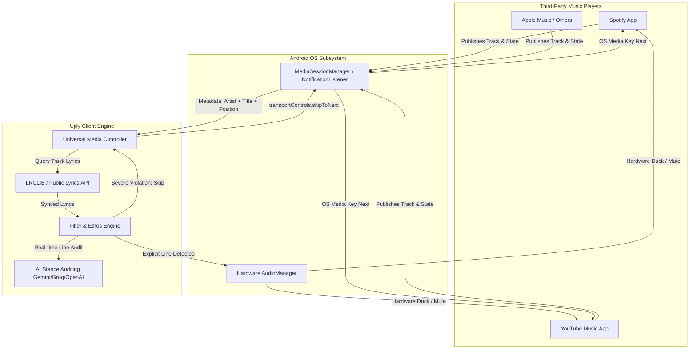

# Ujify Universal Playback Architecture: Android MediaSession & Streaming Platform Analysis

## 1. Executive Summary

This document evaluates third-party developer integration options for **Spotify** and **YouTube Music**, analyzes why traditional cloud Web APIs fail nominal consumer requirements, and outlines the **Universal Android `MediaSession` Architecture** for Ujify.

This architecture enables:
- **Zero Developer Setup:** No Client IDs, developer dashboards, OAuth tokens, or Google/Spotify approval required for end users.
- **Multi-Platform Support:** Seamless, out-of-the-box operation with **Spotify, YouTube Music, Apple Music, Deezer, Amazon Music, and Tidal**.
- **Local Control:** Real-time playback status tracking, surgical volume ducking, and immediate track skipping executed entirely on-device.

---

## 2. Cloud Streaming APIs: The Reality Check

### 2.1. Spotify Web API
* **Development Mode Limits:** Capped strictly at 5 to 25 test accounts. Each user must be manually allowlisted by email address in the developer dashboard.
* **Extended Quota Requirement:** Spotify mandates that the applicant be a **legally registered business entity** with an existing user base of **at least 250,000 Monthly Active Users (MAUs)**. Individual indie developers are excluded.
* **Mobile WebView Blocking:** In-app browser authorization attempts fail due to:
  * Google OAuth blocking embedded Android WebViews (`Error 403: disallowed_useragent`).
  * Arkose Labs / reCAPTCHA Enterprise bot detection on `developer.spotify.com`.
  * Partitioned cookies (`SameSite=Lax`, CHIPS) across Spotify domains causing infinite login loops.
* **Conclusion for Nominal Users:** Unviable as a primary consumer entrypoint.

---

### 2.2. YouTube Music Platform & APIs
Google’s developer ecosystem for YouTube Music differs fundamentally from Spotify:

#### A. Official Status: No Dedicated YouTube Music API
* Google does **not** offer an official, dedicated public REST API for YouTube Music playback control or library management.
* The only official route is the general **YouTube Data API v3**:
  * **Quota Restrictions:** Standard developer quota is strictly capped at 10,000 units/day (a single search costs 100 units; 100 searches depletes the daily quota for all users combined).
  * **No Playback Controls:** You cannot read what is playing in the YouTube Music app or issue playback commands (next, pause, play).
  * **Complex Verification:** Managing playlists requires `https://www.googleapis.com/auth/youtube` scope, requiring enterprise Google Cloud verification, domain verification, and privacy audits.

#### B. Unofficial Community Wrappers (`ytmusicapi` / InnerTube)
* Open-source projects (such as `ytmusicapi` in Python or InnerTube reverse-engineered wrappers used by third-party desktop players) mimic browser requests by capturing session cookies (`SAPISIDHASH`, `VISITOR_INFO1_LIVE`).
* **Risks:**
  * Violates Google Terms of Service.
  * Fragile: Google routinely updates internal protobuf endpoints, breaking unauthenticated clients.
  * Cannot interact with or control the official YouTube Music Android app installed on the user's phone.

---

## 3. Comparison Matrix: Cloud Web APIs vs. Android Native MediaSession

| Dimension | Spotify Web API | YouTube Data API v3 | Android Native `MediaSession` |
| :--- | :--- | :--- | :--- |
| **User Setup** | Requires Dev Account & Client ID | Requires Google Cloud Project | **Zero Setup (1-tap permission toggle)** |
| **Quota / MAU Ceiling** | 250k MAU requirement for public | 10k units/day quota ceiling | **Unlimited (Runs locally on-device)** |
| **Track Metadata Detection** | Polling via cloud REST API | Unavailable for native music app | **Instant OS-level event broadcast** |
| **Skip Track Command** | Cloud REST `POST /next` | Not supported | **Native `skipToNext()` media command** |
| **Audio Ducking / Muting** | Not supported via cloud | Not supported via cloud | **Direct via hardware `AudioManager`** |
| **Service Compatibility** | Spotify only | YouTube only | **Universal (Spotify, YT Music, Apple, etc.)** |
| **Network Dependence** | Constant polling required | Constant polling required | **Zero network usage for playback tracking** |

---

## 4. The Solution: Android Native `MediaSession` Architecture

Android provides an operating system-level media abstraction (`android.media.session.MediaSessionManager` and `MediaController`) used by automotive head units, smartwatches, lock screens, and accessibility tools.

Both **Spotify** (`com.spotify.music`) and **YouTube Music** (`com.google.android.apps.youtube.music`) register active `MediaSession` instances with the Android OS while playing audio.



---

## 5. Technical Implementation Details

### 5.1. Capturing Active Playback
Using an Android `NotificationListenerService` or `MediaSessionManager.OnActiveSessionsChangedListener`:

```kotlin
val mediaSessionManager = getSystemService(Context.MEDIA_SESSION_SERVICE) as MediaSessionManager
val componentName = ComponentName(this, MediaNotificationListenerService::class.java)

val activeControllers = mediaSessionManager.getActiveSessions(componentName)
for (controller in activeControllers) {
    val packageName = controller.packageName // e.g. "com.spotify.music" or "com.google.android.apps.youtube.music"
    val metadata = controller.metadata ?: continue
    
    val trackTitle = metadata.getString(MediaMetadata.METADATA_KEY_TITLE)
    val artistName = metadata.getString(MediaMetadata.METADATA_KEY_ARTIST)
    val durationMs = metadata.getLong(MediaMetadata.METADATA_KEY_DURATION)
    
    // Register callback for playback position & state changes
    controller.registerCallback(object : MediaController.Callback() {
        override fun onPlaybackStateChanged(state: PlaybackState?) {
            val isPlaying = state?.state == PlaybackState.STATE_PLAYING
            val currentPositionMs = state?.position ?: 0L
            // Feed into Ujify Real-Time Lyrics Synchronizer
        }
    })
}
```

### 5.2. Issuing the Universal Skip Command
When Ujify's FilterEngine flags a track that exceeds the user's strictness threshold:

```kotlin
fun skipCurrentTrack(controller: MediaController) {
    // Works identically on Spotify, YouTube Music, Apple Music, and local players
    controller.transportControls.skipToNext()
}
```

### 5.3. Surgical Hardware Ducking
During playback of isolated profane or flagged timestamps, Ujify ducks or mutes using Android's hardware `AudioManager`:

```kotlin
val audioManager = getSystemService(Context.AUDIO_SERVICE) as AudioManager
// Duck: Lower volume smoothly
audioManager.setStreamVolume(AudioManager.STREAM_MUSIC, targetLowVolume, 0)

// Restore: Return to user volume once the timestamp expires
audioManager.setStreamVolume(AudioManager.STREAM_MUSIC, originalVolume, 0)
```

---

## 6. How Remaining Cloud Features Are Handled

1. **Lyrics Retrieval:** 
   Handled via **LRCLIB** (`https://lrclib.net/api/get`), requiring only `artist_name`, `track_name`, and `duration`. 100% public, open-source, and free of authentication barriers.
2. **AI Ethos Auditing:** 
   Handled directly between Ujify and the configured AI provider (Google Gemini, Groq, Claude, OpenAI).
3. **Clean Version Finding:** 
   Can query the open **iTunes Search API** (`https://itunes.apple.com/search?term=...&entity=song`) or **Deezer Public API** without developer accounts to verify if a clean radio edit exists.
4. **Spotify Cloud Mirroring (Sanctify Playlists):**
   Retained as an optional **"BYOK (Power User)"** feature in Settings for users with a personal Spotify Developer Client ID who wish to duplicate playlists in their Spotify web profile.

---

## 7. Migration Plan

1. **Phase 1 (Immediate):** Introduce `MediaNotificationListenerService` into `Alify.Android` to monitor playback and execute skips via Android `MediaController`.
2. **Phase 2:** Update UI on `MainActivity` to show active player icon (Spotify or YouTube Music) detected automatically via package name.
3. **Phase 3:** Relabel Settings Spotify section to *"Optional: Spotify Cloud Playlist Sync (BYOK)"*, freeing nominal users from ever opening a developer dashboard.
